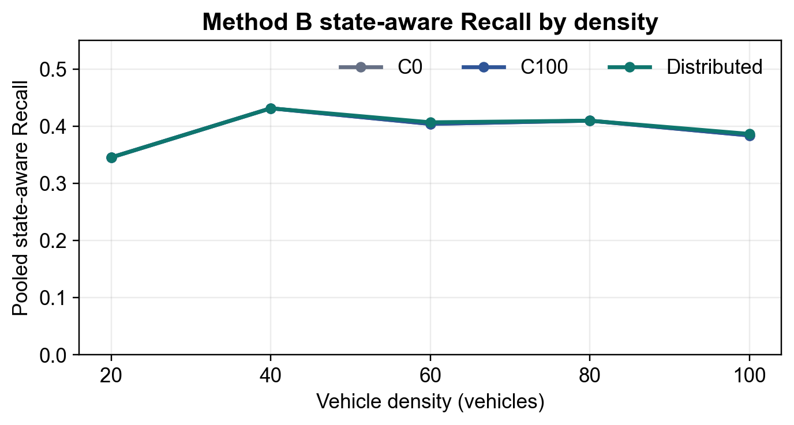
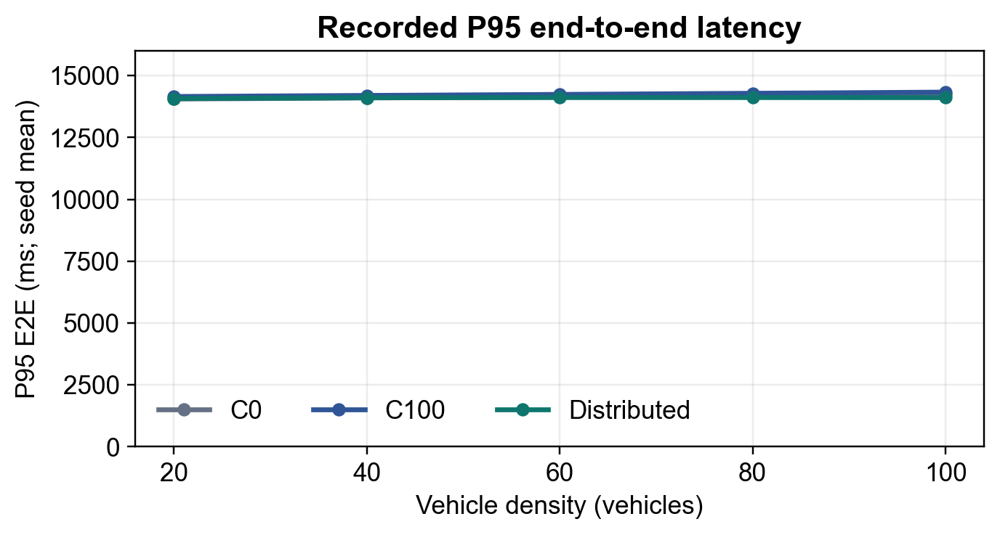
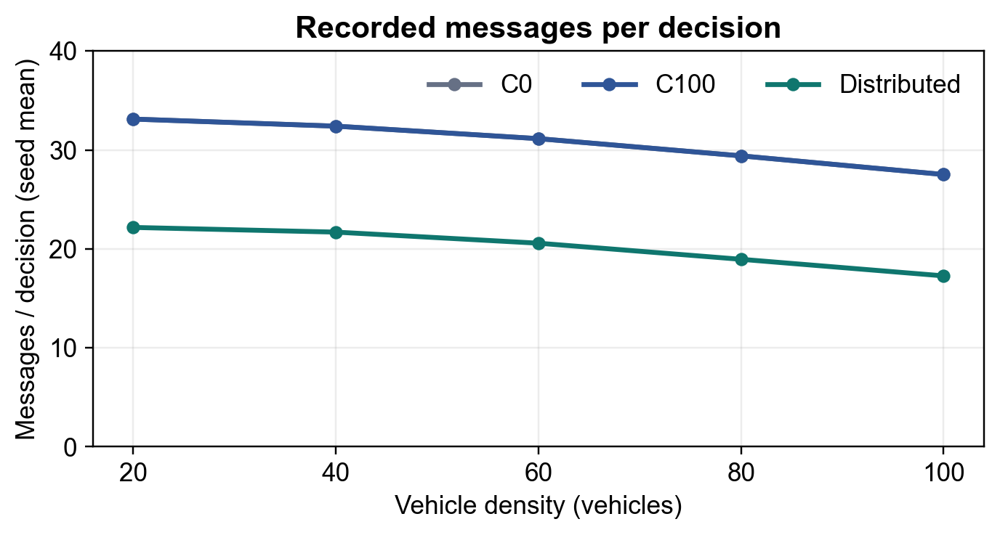
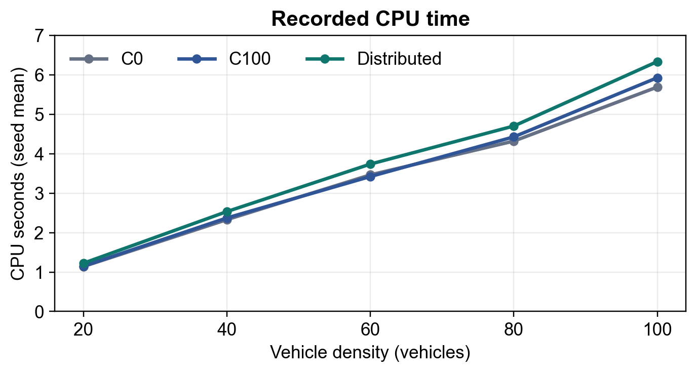

# الفصل الخامس — نتائج وتقييم Scenario 5 المصححة وفق Method B

## نطاق النسخة ومصدر النتائج

**القرار النهائي:** Dataset B corrected-final هي المصدر المعتمد لجداول Method B. Dataset A وHTML التاريخي محفوظان دون تعديل ولا تمثل B إعادة إنتاج لهما. الفصل التاريخي DOCX/PDF ورسومه يخص v7 متعددة الطوبولوجيات، ولا تستخدم أرقامه هنا.

تعرض هذه النسخة نتائج **Scenario 5 — Urban Roundabout** من حملة `urban_roundabout_campaign_corrected_final` (Dataset B) وفق Method B. وهي نسخة مصححة مستقلة أُعدت بجانب الفصل والتقرير المعتمدين؛ لا تستبدلهما ولا تدعي إعادة إنتاج Dataset A التي بُني عليها تقرير الدفاع التاريخي. تبقى Dataset A حملة تاريخية مؤرشفة منفصلة بسبب اختلاف مجموعة الحالات وقراراتها.

لا تستخدم هذه النسخة قيم Recall الخمس التي لم يمكن تتبع مصدرها. كما لا تنقل نتائج v7 أو Phase 6 أو C3 أو تجارب V5 إلى جداول Scenario 5. نتائج V5 الأمنية استكشافية ومنفصلة عن بنية هذه الحملة.

## تصميم الحملة

تغطي Dataset B خمس كثافات للمركبات (20، 40، 60، 80، 100) وعشر بذور (1001–1010)، أي 50 خلية paired. يسجل manifest وجود 50 أثراً مشتركاً وثلاثة تقييمات معمارية لكل أثر. المقارنة تشمل C0 عند 0 ms، وC100 عند 100 ms، وDistributed بالمعمارية الموزعة الأصلية. تختلف مسارات النقل والمعالجة، فلا تعزل المقارنة خوارزمية QE وحدها. استُخدمت إعدادات الحملة الفعلية الواردة في manifest و`effective_config.json`، بما فيها أوزان الثقة ومتطلبات QE ومحددات النقل. لم تُغيّر هذه النسخة بيانات الهجوم أو قواعد التأهيل أو سجل الحالات.

## تعريف التقييم

وحدة العد هي سجل نافذة قرار. التنبؤ الإيجابي هو قرار ملتزم ينقل الحالة إلى `REVOKED`. تطبق Method B استبعاداً طرفياً: الصفوف ذات `reason=already_revoked_terminal_state` لا تدخل في TP/FP/TN/FN، لكنها تظل محسوبة ضمن إجمالي السجلات ويُبلغ عددها منفصلاً.

Recall المعروض هو **state-aware Recall = TP/(TP+FN)** بعد الاستبعاد الطرفي؛ يتغير مقامه إذا أُبطلت المركبة قبل نوافذ لاحقة. لا تحتوي Dataset B على مقام ثابت لفرص الهجوم ولا على protected-opportunity fraction، لذا لا تُفسر هذه النتائج على أنها opportunity-based Recall أو نسبة حماية فرص ثابتة.

## نتائج التصنيف المجمعة عبر البذور

الوحدة سجل نافذة قرار. تُستبعد النوافذ الطرفية فقط من أهلية Method B.

| الكثافة | المعمارية | TP | FP | TN | FN | مؤهل | مستبعد terminal |
|---:|---|---:|---:|---:|---:|---:|---:|
| 20 | C0 | 38 | 0 | 901 | 72 | 1011 | 179 |
| 20 | C100 | 38 | 0 | 901 | 72 | 1011 | 179 |
| 20 | Distributed | 38 | 0 | 901 | 72 | 1011 | 179 |
| 40 | C0 | 88 | 1 | 1770 | 116 | 1975 | 396 |
| 40 | C100 | 88 | 1 | 1770 | 116 | 1975 | 396 |
| 40 | Distributed | 88 | 1 | 1770 | 116 | 1975 | 396 |
| 60 | C0 | 141 | 0 | 2578 | 208 | 2927 | 595 |
| 60 | C100 | 141 | 0 | 2578 | 208 | 2927 | 595 |
| 60 | Distributed | 142 | 0 | 2575 | 207 | 2924 | 598 |
| 80 | C0 | 177 | 1 | 3444 | 255 | 3877 | 774 |
| 80 | C100 | 177 | 1 | 3444 | 255 | 3877 | 774 |
| 80 | Distributed | 177 | 1 | 3444 | 255 | 3877 | 774 |
| 100 | C0 | 195 | 7 | 4288 | 313 | 4803 | 881 |
| 100 | C100 | 195 | 7 | 4288 | 313 | 4803 | 881 |
| 100 | Distributed | 196 | 7 | 4284 | 311 | 4798 | 886 |

### المقاييس pooled حسب الكثافة

| الكثافة | المعمارية | Precision | Recall pooled | FRR | F1 | MCC |
|---:|---|---:|---:|---:|---:|---:|
| 20 | C0 | 100.00% | 34.55% | 0.00% | 0.5135 | 0.5656 |
| 20 | C100 | 100.00% | 34.55% | 0.00% | 0.5135 | 0.5656 |
| 20 | Distributed | 100.00% | 34.55% | 0.00% | 0.5135 | 0.5656 |
| 40 | C0 | 98.88% | 43.14% | 0.06% | 0.6007 | 0.6320 |
| 40 | C100 | 98.88% | 43.14% | 0.06% | 0.6007 | 0.6320 |
| 40 | Distributed | 98.88% | 43.14% | 0.06% | 0.6007 | 0.6320 |
| 60 | C0 | 100.00% | 40.40% | 0.00% | 0.5755 | 0.6114 |
| 60 | C100 | 100.00% | 40.40% | 0.00% | 0.5755 | 0.6114 |
| 60 | Distributed | 100.00% | 40.69% | 0.00% | 0.5784 | 0.6137 |
| 80 | C0 | 99.44% | 40.97% | 0.03% | 0.5803 | 0.6156 |
| 80 | C100 | 99.44% | 40.97% | 0.03% | 0.5803 | 0.6156 |
| 80 | Distributed | 99.44% | 40.97% | 0.03% | 0.5803 | 0.6156 |
| 100 | C0 | 96.53% | 38.39% | 0.16% | 0.5493 | 0.5856 |
| 100 | C100 | 96.53% | 38.39% | 0.16% | 0.5493 | 0.5856 |
| 100 | Distributed | 96.55% | 38.66% | 0.16% | 0.5521 | 0.5879 |

### المتوسط الحسابي macro عبر البذور

المتوسط غير الموزون لعشر نسب seed-level، وليس نسبة محسوبة من المجاميع.

| الكثافة | المعمارية | Precision macro | Recall macro | FRR macro | F1 macro | MCC macro |
|---:|---|---:|---:|---:|---:|---:|
| 20 | C0 | 100.00% | 34.55% | 0.00% | 0.5124 | 0.5648 |
| 20 | C100 | 100.00% | 34.55% | 0.00% | 0.5124 | 0.5648 |
| 20 | Distributed | 100.00% | 34.55% | 0.00% | 0.5124 | 0.5648 |
| 40 | C0 | 98.89% | 43.52% | 0.06% | 0.6017 | 0.6335 |
| 40 | C100 | 98.89% | 43.52% | 0.06% | 0.6017 | 0.6335 |
| 40 | Distributed | 98.89% | 43.52% | 0.06% | 0.6017 | 0.6335 |
| 60 | C0 | 100.00% | 40.44% | 0.00% | 0.5755 | 0.6115 |
| 60 | C100 | 100.00% | 40.44% | 0.00% | 0.5755 | 0.6115 |
| 60 | Distributed | 100.00% | 40.71% | 0.00% | 0.5784 | 0.6137 |
| 80 | C0 | 99.47% | 41.03% | 0.03% | 0.5806 | 0.6159 |
| 80 | C100 | 99.47% | 41.03% | 0.03% | 0.5806 | 0.6159 |
| 80 | Distributed | 99.47% | 41.03% | 0.03% | 0.5806 | 0.6159 |
| 100 | C0 | 96.52% | 38.43% | 0.16% | 0.5494 | 0.5858 |
| 100 | C100 | 96.52% | 38.43% | 0.16% | 0.5494 | 0.5858 |
| 100 | Distributed | 96.55% | 38.69% | 0.16% | 0.5522 | 0.5880 |

### المجاميع الكلية

| المعمارية | TP | FP | TN | FN | مؤهل | مستبعد | Precision | Recall state-aware | FRR | F1 | MCC |
|---|---:|---:|---:|---:|---:|---:|---:|---:|---:|---:|---:|
| C0 | 639 | 9 | 12981 | 964 | 14593 | 2825 | 98.61% | 39.86% | 0.07% | 0.5677 | 0.6041 |
| C100 | 639 | 9 | 12981 | 964 | 14593 | 2825 | 98.61% | 39.86% | 0.07% | 0.5677 | 0.6041 |
| Distributed | 641 | 9 | 12974 | 961 | 14585 | 2833 | 98.62% | 40.01% | 0.07% | 0.5693 | 0.6053 |

## الأداء المسجل

القيم متوسطات عشر قيم seed-level. P95 E2E بالميلي ثانية وCPU بالثانية. تأخير السجل يأتي بعد الإنهاء.

### زمن الاستجابة والمعالجة

| الكثافة | المعمارية | P95 E2E (ms) | CPU (s) |
|---:|---|---:|---:|
| 20 | C0 | 14058.3 | 1.141 |
| 20 | C100 | 14158.3 | 1.150 |
| 20 | Distributed | 14075.2 | 1.225 |
| 40 | C0 | 14100.9 | 2.330 |
| 40 | C100 | 14200.9 | 2.373 |
| 40 | Distributed | 14109.1 | 2.534 |
| 60 | C0 | 14142.5 | 3.466 |
| 60 | C100 | 14242.5 | 3.423 |
| 60 | Distributed | 14116.2 | 3.739 |
| 80 | C0 | 14188.3 | 4.322 |
| 80 | C100 | 14288.3 | 4.430 |
| 80 | Distributed | 14116.7 | 4.705 |
| 100 | C0 | 14234.8 | 5.692 |
| 100 | C100 | 14334.8 | 5.930 |
| 100 | Distributed | 14113.7 | 6.339 |

### النقل والسجل

| الكثافة | المعمارية | رسائل/قرار | PDR | P95 تأخير السجل (ms) |
|---:|---|---:|---:|---:|
| 20 | C0 | 33.115 | 0.97985 | 1.000 |
| 20 | C100 | 33.115 | 0.97985 | 1.000 |
| 20 | Distributed | 22.164 | 0.97968 | 14.195 |
| 40 | C0 | 32.401 | 0.97996 | 1.000 |
| 40 | C100 | 32.401 | 0.97996 | 1.000 |
| 40 | Distributed | 21.691 | 0.97997 | 16.530 |
| 60 | C0 | 31.138 | 0.98000 | 1.000 |
| 60 | C100 | 31.138 | 0.98000 | 1.000 |
| 60 | Distributed | 20.570 | 0.98008 | 15.868 |
| 80 | C0 | 29.400 | 0.97993 | 1.000 |
| 80 | C100 | 29.400 | 0.97993 | 1.000 |
| 80 | Distributed | 18.943 | 0.97997 | 15.625 |
| 100 | C0 | 27.513 | 0.98006 | 1.000 |
| 100 | C100 | 27.513 | 0.98006 | 1.000 |
| 100 | Distributed | 17.268 | 0.98018 | 16.038 |

المسار المركزي لا يتضمن PBFT؛ لا توجد نسبة موحدة موثقة لـconsensus/ledger overhead. CPU وP95 E2E قيم محفوظة وليست إعادة بناء مستقلة من profiler.

**الشكل 5-1: Recall الحالة pooled حسب الكثافة والمعمارية.** المصدر: مقاييس Dataset B المحفوظة.

**الشكل 5-2: P95 E2E المسجل ومحوره يبدأ من الصفر.** المصدر: مقاييس Dataset B المحفوظة.

**الشكل 5-3: الرسائل المسجلة لكل قرار، متوسط seed-level.** المصدر: مقاييس Dataset B المحفوظة.

**الشكل 5-4: CPU المسجل بالثواني، متوسط seed-level.** المصدر: مقاييس Dataset B المحفوظة.

## المقارنة على مستوى الهوية وتوافر الخادم

تطابقت الهويات الثلاث 17,418/17,418؛ لا حالات غير متطابقة. تطابقت حقول القرار والحالة والسبب بين C0 وC100. اختلف قرار الإبطال الأولي بين C100 وDistributed في حالتين خبيثتين فقط، وبقيت هويات FP التسع متطابقة.

| الكثافة | البذرة | case_id | المركبة | الهجوم | C100 | Distributed |
|---:|---:|---|---|---|---|---|
| 60 | 1002 | case-urban_roundabout-1002-veh_044-w0002 | veh_044 | speed_offset | central_server_unavailable؛ لا إبطال ملتزم | إبطال ملتزم عند 44.112420255 s |
| 100 | 1004 | case-urban_roundabout-1004-veh_020-w0001 | veh_020 | position_offset | central_server_unavailable؛ لا إبطال ملتزم | إبطال ملتزم عند 29.102440446 s |

تلت ذلك ثماني نوافذ terminal إضافية في Distributed: واحدة خبيثة وسبع حميدة. وُسم 75 صفاً بـcentral_server_unavailable في كل من C0 وC100؛ الحالتان أعلاه فقط هما فرق الإبطال الأولي بين C100 وDistributed. التفسير هو اختلاف التوافر في المسار المحاكى، لا إثبات تفوق خوارزمية QE أو PBFT. كما تغيّر مقام Recall بسبب الاستبعاد الطرفي: 14,593 مؤهلة في C100 و14,585 في Distributed.

## تفسير النتائج

تتقارب نتائج C100 وDistributed؛ Recall الحالة pooled يساوي 39.8628% و40.0125% على الترتيب، مع تسع حالات FP متطابقة الهوية. ارتبط قرارا الإبطال الأوليان المختلفان بتعذر إتمام المسار المركزي في حالتين. لا تعزل هذه النتيجة خوارزمية التأهيل أو الإجماع وحدها.

تطابق C0 وC100 تصنيفياً رغم فرق backhaul الإضافي 100 ms. تسجيل 75 سبباً لعدم توافر الخادم في كل منهما لا يعني أن التصنيف اختلف. لا تظهر المقارنة أفضلية كشف خوارزمية لـDistributed.

Recall هو state-aware بعد استبعاد النوافذ الطرفية. لا يتوفر في Dataset B مقام ثابت لفرص الهجوم أو fixed-universe protection fraction، فلا تستنتج منه هذه المقاييس.

## القيود وإعادة الإنتاج

- سجل manifest يصف paired traces، وتتطابق سجلات الحالات في الهوية والحقيقة المرجعية ونوع الهجوم، كما لا يسجل transport audit مخالفات سببية. لكن ملفات الحركة والهجوم الخام غير موجودة في مجلد Dataset B؛ لذلك لا يمكن إعادة تشغيل الحملة أو إثبات التطابق البايتّي للمدخلات من الملفات المتاحة.
- Dataset B لا توفر fixed-denominator opportunity Recall أو protected-opportunity fraction. لا يجوز استبدالهما بـ Recall state-aware.
- إعداد الحملة هو manifest و`effective_config.json`. ملف `configs/urban_roundabout_campaign.json` لا يطابق بعض قيم التشغيل، ولا يُستخدم وحده دليلاً على الإعداد الفعلي.
- النتائج تخص معمارية Distributed الأصلية ذات أربعة validators؛ لا تنطبق عليها نتائج V5 ذات الخمسة validators.
- لا تثبت المحاكاة تحمل Byzantine طرفاً إلى طرف. حذف الأدلة المعارضة من قبل المنسق، واكتمال الأدلة، واستعادة المنسق الآمنة تظل مسائل غير محسومة. ولا ينبغي تقديم هذا الفصل على أنه إثبات full Byzantine fault tolerance.

تُراجع أرقام هذا الفصل في [سجل Method B المحقق](../final_scenario5_evidence_package/METHOD_B_CORRECTED_FINAL/SCENARIO5_METHOD_B_VERIFIED_METRICS.csv)، وتعريفات المقاييس في [ملف التعريفات](../final_scenario5_evidence_package/METHOD_B_CORRECTED_FINAL/SCENARIO5_METHOD_B_METRIC_DEFINITIONS_AR.md)، وبصمات المدخلات في [ملف provenance](SCENARIO5_METHOD_B_PROVENANCE.json).
## الدراسات التكميلية وحدود الأمن

دراسات Phase 1–6، وتوسعة 8-RSU، وV5، والمنسق الحتمي، وتوافر الأدلة، والحساسية وAblation تكميلية ومنفصلة عن Dataset B. في Phase 6 زادت الفرص المرصودة 948 إلى 953 (+5)، بخمس خلايا تحسن و15 ثابتة. ارتفعت الحماية على المقام الثابت 455/1,086 إلى 501/1,086 (+46): منها +21 فرصة مكتشفة في نافذتها و+25 فرصة طرفية حُميت بعد إبطال سابق. ليست +46 اكتشافات جديدة.

طيار 8-RSU تجاوز حد CPU (+44.27%) والرسائل لكل حالة (+37.12%)، ولذلك هو NO-GO. تحليل الحساسية اكتمل في 103/120 خلية؛ و17 لم تبدأ بسبب حد زمن التنفيذ. اكتمل Ablation في 48/48. المتغير C أزال بوابات تنوع الجذر والمصدر والمنطقة والوسيط، ولذلك فهو مقابل أضعف أمنياً لا إعداداً مقترحاً. عند الكثافة 20 ارتفع TP من 15 إلى 28 في C100 وDistributed؛ وتغيرت النوافذ المؤهلة/الطرفية من 402/74 إلى 342/134 في C100 ومن 402/74 إلى 341/135 في Distributed. وعند الكثافة 100 ارتفع TP من 79 إلى 137 في المعماريتين، وتغيرت المؤهلة/الطرفية من 1,923/357 إلى 1,657/623. بقي مقام فرص الهجوم ثابتاً (1,700 عند الكثافة 20 و7,612 عند 100): في C100 زادت الفرص المكتشفة/المحمية من 227/142 إلى 781/546 عند الكثافة 20، وفي Distributed إلى 774/561؛ وعند الكثافة 100 زادت من 2,179/1,106 إلى 3,298/2,828 في المعماريتين. لم تظهر FP جديدة في العينة، وانخفض FP من 1 إلى 0 عند الكثافة 20 ومن 2 إلى 0 عند 100؛ لا يثبت ذلك السلامة خارج العينة ولا يعوض إلغاء شروط الاستقلال. بقي خط الأساس الأصلي كما هو.

تجارب V5 والمنسق الحتمي وحد single-view وتوافر الأدلة منفصلة واستكشافية. لا تثبت تحمل Byzantine طرفاً إلى طرف؛ لا يوجد VIEW-CHANGE/NEW-VIEW كامل أو استعادة منسق آمنة. حجب الأدلة المعارضة من المنسق ثغرة مثبتة، والتوقيع لا يثبت اكتمال الأدلة.